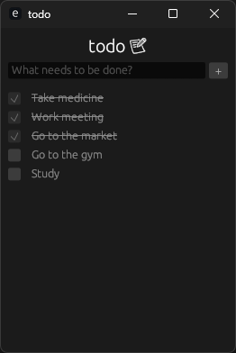

# todo

A simple, elegant ToDo application written in Rust, utilizing the `eframe` and `egui` libraries for building a user-friendly graphical interface 📝🦀

---

## Features ✨

- **Add tasks**: Quickly add tasks with a single line of input or multiple lines.
- **Mark tasks as completed**: Use checkboxes to mark tasks as completed.
- **Auto-reset**: Automatically resets the task list when all tasks are marked as completed.
- **Clean and compact UI**: Built with a responsive and minimalistic design.

---

## Screenshots 📷

### Main Interface



---

## Prerequisites 📋

To build and run the project, ensure you have the following installed:

- [Rust](https://www.rust-lang.org/) (latest stable version recommended)
- Cargo (Rust's package manager, included with Rust)

---

## Getting Started 🚀

### 1. Clone the Repository

```bash
$ git clone https://github.com/vilsonfcastilho/todo.git
$ cd todo
```

### 2. Build the Application

```bash
$ cargo build --release
```

### 3. Run the Application

```bash
$ cargo run
```

---

## Code Overview 🛠️

### Main Components

1. **`todoapp.rs`**:

   - Contains the core logic for the To-Do application, including task management and UI rendering.
   - Key functions:
     - `update`: Handles the user interface updates, including adding tasks, marking them as completed, and resetting the list when all tasks are complete.

2. **`main.rs`**:
   - Sets up the `eframe` application with custom window options.
   - Initializes and runs the `TodoApp` instance.

### UI Features

- **Input and Add Button**:
  - Enter a task in the input box, and click the `+` button or press `Enter` to add it to the list.
- **Task List**:
  - Displays all tasks with checkboxes.
  - Completed tasks are shown with a strikethrough style.
- **Automatic Reset**:
  - When all tasks are completed, the list is cleared and reset.

---

## Dependencies 📦

This project uses the following Rust crates:

- [`eframe`](https://crates.io/crates/eframe) - Framework for building GUI applications.
- [`egui`](https://crates.io/crates/egui) - Immediate mode GUI library for Rust.

Add these dependencies to your `Cargo.toml` file if you're setting up manually:

```toml
[dependencies]
eframe = "0.29.1"
egui = "*"
```

---

## Acknowledgments 🙌

- [eframe Documentation](https://docs.rs/eframe/latest/eframe/)
- [egui Examples](https://github.com/emilk/egui)

---

## Contact 📧

For any inquiries or feedback, feel free to reach out via GitHub or email.

---

Made with ♥ by Vilson Castilho
